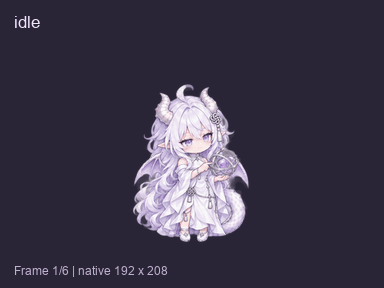
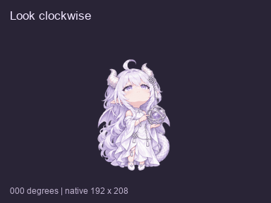

# 星璃 · Xingli

<p align="center">
  <a href="./assets/xingli.png"></a>
</p>

<p align="center"><em>星璃成品立绘</em></p>

星璃是为支持 v2 自定义宠物的 ChatGPT（Codex）桌面版制作的小龙娘。她有银白色长发、淡紫色眼睛和一对小龙翼，工作时会专注地拨动手里的银色星仪。Codex 在最初的设计方案里取了这个名字。「星」来自她的星仪，「璃」取自琉璃，呼应白紫配色。

[安装](#安装) · [动作演示](#动作演示) · [常见问题](#常见问题) · [来源与署名](#来源与署名)

## 安装

**桌面版安装链接**

在 Windows 上按 **Win + R**，粘贴下面这一整行，按回车。如果应用打开宠物安装窗口，按提示确认。

```text
codex://pets/install?name=%E6%98%9F%E7%92%83&imageUrl=https%3A%2F%2Fraw.githubusercontent.com%2FAa1-t7%2FXingli-codex-pet%2Fmain%2Fspritesheet.webp&spriteVersionNumber=2
```

这个链接需要桌面应用支持宠物安装功能。若没有打开安装窗口，可用下面的手动方法。 [官方安装链接说明](https://learn.chatgpt.com/docs/app/commands#pets)

**Windows 手动安装**

1. 下载 [pet.json](https://raw.githubusercontent.com/Aa1-t7/Xingli-codex-pet/main/pet.json) 和 [spritesheet.webp](https://raw.githubusercontent.com/Aa1-t7/Xingli-codex-pet/main/spritesheet.webp)。如果浏览器直接显示文件，可以右键链接选择「链接另存为」，保存时核对文件名。
2. 在资源管理器打开 `%USERPROFILE%\.codex`，创建 `pets\xingli`，把两个文件放进去。如果设置了自定义 `CODEX_HOME`，就在该目录下创建 `pets\xingli`。
3. 打开桌面应用的 **设置 → Pets（宠物）**，刷新列表并选择「星璃」。
4. 在聊天框输入 `/pet`，或从命令菜单选择 **Show pet（显示宠物）**。

默认安装目录如下：

```text
%USERPROFILE%\.codex\pets\xingli\
├── pet.json
└── spritesheet.webp
```

## 动作演示



*九种动画素材依次循环播放。左上角是动作名称，底部显示该动作的帧序号。*

| 场景 | 动画名称 | 星璃怎么动 | 如何看到 |
| --- | --- | --- | --- |
| 待机 | `idle` | 轻轻呼吸、眨眼，发梢和尾尖微动。 | 待机用的基础循环。 |
| 向左移动 | `running-left` | 朝屏幕左侧迈小步，裙摆和尾巴随动。 | 用于向左拖动时的移动表现，由桌面应用播放。 |
| 向右移动 | `running-right` | 朝屏幕右侧迈小步，裙摆和尾巴随动。 | 用于向右拖动时的移动表现，由桌面应用播放。 |
| 打招呼 | `waving` | 一只手托住星仪，另一只手轻轻招手。 | 可在 GIF 中查看。桌面端的具体触发手势尚未验证。 |
| 小跳 | `jumping` | 先屈膝，再小跳并轻展龙翼，最后落回原位。 | 鼠标指针移到星璃身上时触发。 |
| 出错或受阻 | `failed` | 微微皱眉，低头看向星仪，龙翼略垂。 | 为失败情境设计。应用的 `Blocked` 表示会话失败或遇到系统错误。 |
| 等待输入 | `waiting` | 抬头看向你，微微歪头。 | 为等待回应设计。应用的 `Needs input` 表示需要你批准、回答或做决定。 |
| 正在工作 | `running` | 站在原地，专注地拨动星仪圆环。 | 为工作过程设计。应用的 `Running` 表示会话正在处理任务。 |
| 检查结果 | `review` | 凑近看星仪，再轻轻点头。 | 应用的 `Ready` 表示会话已完成且有未读动态。**尚未验证任务完成时会自动播放点头。** |

桌面应用决定实际播放时机。表中描述的是星璃为各场景准备的动作，以及官方文档说明的应用状态。你可以拖动桌宠改变位置。左右移动用的是两套分别绘制的动作，星仪和发饰保留在原来的侧边。 [官方宠物操作与状态](https://learn.chatgpt.com/docs/pets#understand-pet-status)

**16 个注视方向**



*从屏幕正上方的 0° 开始，每隔 22.5° 一个姿态。90° 向右，180° 向下，270° 向左。*

眼睛和头部随方向轻转，双脚和托住星仪的手保持稳定。GIF 把姿态按顺时针串起来，便于比较相邻方向。桌面上的实时表现取决于应用如何使用这些姿态。

## 图集规格

| 项目 | 规格 |
| --- | --- |
| 宠物格式 | v2，透明 WebP |
| 图集尺寸 | 1536 × 2288 像素 |
| 排列 | 8 列 × 11 行，每格 192 × 208 像素 |
| 内容 | 9 组动画、16 个注视姿态，共 73 个有效画面 |
| 安装文件 | `pet.json` 和 `spritesheet.webp` |

## 常见问题

**宠物列表里找不到星璃**

先确认两个文件同在 `pets\xingli` 下，文件名与上面一致。到 **设置 → Pets** 刷新，仍未出现可重启应用。如果连 Pets 入口都没有，检查应用是否已更新，以及所在工作区是否开放宠物功能。

**桌宠太小，看不清细节**

打开 **设置 → Pets → Customize（自定义）→ Pet size（宠物大小）**。README 顶部的高清立绘可以点开查看细节，桌宠本身仍使用每格 192 × 208 像素的动画画面。

**星璃只显示静止画面**

如果星璃一直不动，先按 **Win + U**，进入 Windows 的 **辅助功能 → 视觉效果**，确认 **动画效果** 已打开。这个开关关闭时，桌面宠物只显示静态帧。开启后如果星璃还没动，可以用 `/pet` 先隐藏再重新显示她。 [微软设置说明](https://support.microsoft.com/en-us/accessibility/windows/make-it-easier-to-focus-on-tasks) · [官方宠物说明](https://learn.chatgpt.com/docs/pets#reduce-animation)

**能把这个包上传到 ChatGPT 网页版吗？**

这个包使用桌面 v2 的 **1536 × 2288** 图集。官方文档里的网页版上传要求是 **1536 × 1872** 的透明 PNG 或 WebP，因此需要另行制作符合网页规格的图集。 [平台支持与上传规格](https://learn.chatgpt.com/docs/pets#upload-a-custom-pet)

## 来源与署名

| 署名 | 贡献与出处 |
| --- | --- |
| **ZipZipPipe** | GPT 龙娘角色原设。见 [B 站原作者主页](https://space.bilibili.com/4168597)和 [作者发布的角色图集](https://www.bilibili.com/opus/1233069202138464289)。 |
| **ApprenTice** | 项目直接参考的 Q 版形象《ChatGPT-Chibi.png》，由 ApprenTice 基于原设进行 AI 辅助改编。见 [Q 版参考图原帖](https://github.com/Apprentice-Geo/AI-Fanworks/blob/ee1f5176710f3bcfd60ee5cb0af00f77ed96748e/ApprenTice/AI-Girls-and-Chibis/ChatGPT-Chibi.png)和 [作者的来源与授权说明](https://github.com/Apprentice-Geo/AI-Fanworks/blob/ee1f5176710f3bcfd60ee5cb0af00f77ed96748e/ApprenTice/AI-Girls-and-Chibis/README.md)。 |
| **Aa1-t7** | 提供参考图，发起并维护星璃项目。 |
| **Codex / OpenAI ImageGen** | Codex 协助命名、动作设计和图集编排，使用 ImageGen 根据参考形象制作透明立绘与分帧动画。 |

制作时参考了 [legeling 的 Awesome Codex Pet](https://github.com/legeling/awesome-codex-pet) 中的宠物包结构，以及 [OpenAI Pets 文档](https://learn.chatgpt.com/docs/pets)与[桌面安装链接说明](https://learn.chatgpt.com/docs/app/commands#pets)。

星璃是社区同人桌宠。为适配桌面尺寸，本项目去除了参考图的星空背景，重新制作了透明立绘、动作帧和注视姿态。原始参考图可从上面的作者链接查看。

**美术素材许可**　本项目的星璃立绘、演示 GIF 和动画图集按 [CC BY-NC-SA 4.0（署名、非商业性使用、相同方式共享）](https://creativecommons.org/licenses/by-nc-sa/4.0/deed.zh-hans) 分享。非商业转载或改编时，请保留上述作者署名、作品出处与许可证链接，注明改动，并以同一许可证分享改编素材。上游作品适用其作者各自的授权声明。
